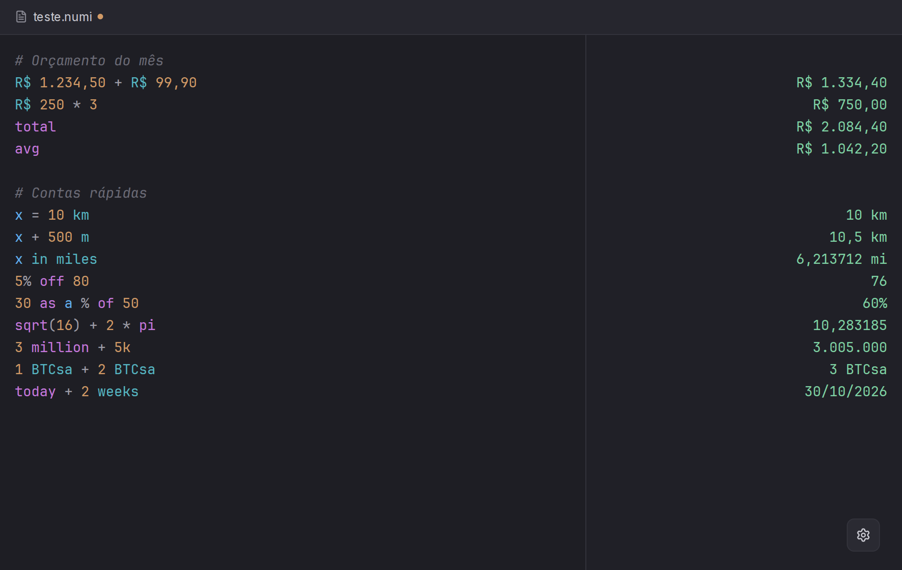
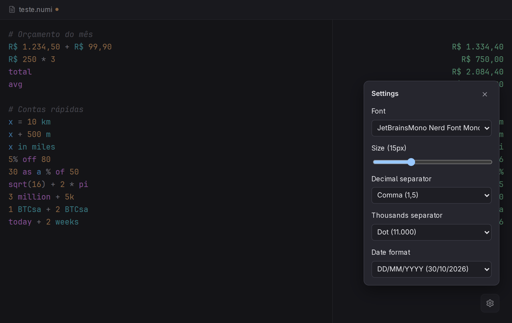

<p align="center">
  
</p>

# Numinator

<p align="center">
  
</p>

A notational calculator — a text editor where every line can be a calculation, with the result shown live in a column on the right. Inspired by apps like [Numi](https://numi.app) and Soulver.

```
20 + 5% of 20        21
x = 10 km            10 km
x + 500 m            10.5 km
x in miles           6.213712 mi
prev * 2             12.427424 mi
R$ 1.234,50 + R$ 10  R$ 1.244,50
5% off 80            76
sqrt(16) + 2 * pi    10.283185
today + 2 weeks      Oct 1, 2026
1 + 1 = 2            true
```

## Features

- Arithmetic with `+ - * / ^ mod`, parentheses, and word operators (`plus`, `times`, `divided by`...)
- Unit conversion (length, mass, time, digital data) via `in` / `to`
- Custom units: any unknown word after a number is a unit of its own (`1 BTCsa + 2 BTCsa` = `3 BTCsa`); different units can't be mixed
- Money: `R$`, `$`, `€`, `£`, `¥` (prefix or suffix, or `usd`, `brl`...). Results follow each currency's own convention (`R$ 1.234,50`, `$ 1,234.50`). Different currencies can't be mixed (no exchange rates)
- Numbers with a decimal comma or dot (`1,5` = `1.5`, `11000,00` = `11.000,00`); decimal and thousands separators are configurable in Settings
- Scales: `5k`, `2M`, `3 million`, `1.5 billion`
- Percentages: `20% of 50`, `50 + 20%`, `5% on 30`, `5% off 30`, `30 as a % of 50`, `20 is 5% of what`
- Functions `sqrt cbrt abs round ceil floor ln log log2 sin cos tan asin acos atan fact` and constants `pi`, `e`
- `sum`/`total` and `average`/`avg` of the lines above (up to the previous blank line or `#` heading)
- Variables (`x = 10`) and `prev` (previous line's result)
- Dates: `today`, `now`, `tomorrow`, `yesterday`, and date arithmetic (`today + 2 weeks`)
- Comparisons: `==`, `===`, `!=`, `!==`, `<`, `<=`, `>`, `>=`, returning `true`/`false`
- Syntax highlighting in the editor
- Native file save/open (`.numi` files) via the OS file dialogs and the app's File menu
- Configurable editor font/size, number separators and date format (system, `DD/MM/YYYY`, `MM/DD/YYYY`, `YYYY-MM-DD`)

<p align="center">
  
</p>

## Development

```bash
npm install
npm run dev      # starts Vite + Electron in dev mode
```

## Build

```bash
npm run build          # type-check + build the renderer and main process
npm run dist:linux     # package a portable Linux AppImage into release/
npm run dist:mac       # package a macOS .dmg/.zip (must run on macOS)
npm run dist:win       # package a Windows .exe installer
```

## Releases

Pushing a version tag (`v*.*.*`) triggers [`.github/workflows/release.yml`](.github/workflows/release.yml), which builds macOS, Linux, and Windows packages on their native GitHub-hosted runners and publishes them to the repo's [Releases](../../releases) page.

```bash
npm version patch   # bumps package.json and creates a git tag, e.g. v0.1.1
git push --follow-tags
```

## Project structure

```
electron/          Electron main process + preload script (file I/O, native menu)
src/engine/         The calculation engine: tokenizer, parser, evaluator, unit catalogue
src/components/     UI components (editor, results column, toolbar, settings)
src/highlight.ts     Syntax highlighting, built on the engine's own tokenizer
```
